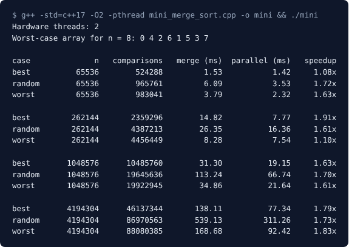

<h1 align="center">Merge Sort vs Multithreaded Merge Sort</h1>
<h3 align="center">Design and Analysis of Algorithms (410241) - Mini-Project Report</h3>
<p align="center">Laboratory Practice III (410246)</p>

<hr/>

<h2 align="center">1\. Problem Statement</h2>

Implement merge sort and multithreaded merge sort. Compare the time required by both algorithms. Also analyse the performance of each algorithm for the best case and the worst case.

<h2 align="center">2\. Objectives</h2>

1. Implement merge sort (divide and conquer) and count the comparisons it makes.
2. Implement a multithreaded merge sort in which the two halves are sorted by different threads.
3. Compare the run time of the two versions for different array sizes.
4. Build a best-case, a worst-case and a random input, and analyse both algorithms on each of them.
5. Check the measured comparison counts against the formulas.

<h2 align="center">3\. Methodology</h2>

**Merge sort.** An array is split into two halves, each half is sorted recursively, and the two sorted halves are merged into one. A merge repeatedly compares the front elements of the two halves and copies the smaller one.

- Recurrence: T(n) = 2T(n/2) + O(n), which gives **O(n log n)** time in every case.
- Space: O(n) for the temporary array used by the merge.

**Multithreaded merge sort.** The two recursive calls work on different parts of the array, so they do not depend on each other. The multithreaded version starts a new thread for the left half and sorts the right half in the current thread. After `join()` the two halves are merged. Two limits keep it efficient:

- Threads are created only for the first 3 levels of splitting, so at most 8 parts are sorted at the same time (`THREAD_DEPTH = 3`).
- Parts smaller than 10,000 elements are sorted without creating a thread (`MIN_PARALLEL`), because creating a thread costs more than it saves on small parts.

The last merges near the top are done by one thread each, so the speed-up is limited by the number of cores.

**Cases analysed.** The number of comparisons depends on how the elements are arranged:

| Case | Input | Comparisons in one merge of two halves | Total for n = 2^k |
|---|---|---|---|
| Best | Already sorted: every element of the left half is smaller than the right half | Only the left half is compared (size / 2) | (n / 2) log2 n |
| Random | Random order | In between | about n log2 n - 1.25 n |
| Worst | Elements alternate between the halves (`0 4 2 6 1 5 3 7` for n = 8) | Every element but one is compared (size - 1) | n log2 n - n + 1 |

The worst-case array is built by undoing the merge level by level: the even positions go to the left half and the odd positions to the right half, recursively. Array sizes are powers of two (2^16, 2^18, 2^20, 2^22), so the formulas are exact.

<h2 align="center">4\. Implementation Details</h2>

The program is one C++17 file, `daa/mini_merge_sort.cpp`, using only the standard library (`vector`, `thread`, `chrono`, `algorithm`, `random`).

| Function | Purpose |
|---|---|
| `mergeParts` | Merges two sorted parts of the array through a temporary array and returns the number of comparisons |
| `mergeSort` | Sequential recursive merge sort, returns the comparisons |
| `parallelMergeSort` | Same algorithm, but starts a `std::thread` for the left half down to `THREAD_DEPTH` levels |
| `bestCase`, `randomCase`, `worstCase` | Build the three kinds of input (random uses a fixed seed 42, so every run is the same) |
| `timeSort` | Sorts a copy of the input 3 times, checks that the result is sorted, and keeps the fastest time |

The threads write to different parts of the arrays, so no locks are needed. Time is measured with `std::chrono::steady_clock`.

**Compile and run**

```
cd lp3-code/daa
g++ -std=c++17 -O2 -pthread mini_merge_sort.cpp -o mini
./mini              # Windows: mini.exe
```

<h2 align="center">5\. Results</h2>

**Test machine:** cloud server, Intel Xeon @ 2.80 GHz, 2 cores (`Hardware threads: 2`), 7 GB RAM, g++ 13.3 on Ubuntu 24.04, compiled with `-O2 -pthread`. Timings vary a little between runs on a shared server, so read the trend, not exact values.

<p align="center"></p>
<p align="center"><em>Figure 1: Output of mini_merge_sort.cpp</em></p>

**5.1 Comparisons (the same for both versions, because both do the same merges).** The best and worst case match the formulas exactly.

| n | Best: theory = measured | Random: measured | Worst: theory = measured |
|---|---|---|---|
| 65,536 (2^16) | 524,288 | 965,761 | 983,041 |
| 262,144 (2^18) | 2,359,296 | 4,387,213 | 4,456,449 |
| 1,048,576 (2^20) | 10,485,760 | 19,645,636 | 19,922,945 |
| 4,194,304 (2^22) | 46,137,344 | 86,970,563 | 88,080,385 |

**5.2 Time in milliseconds (best of 3 runs), merge sort / multithreaded (speed-up).**

| n | Best case | Random | Worst case |
|---|---|---|---|
| 2^16 | 1.53 / 1.42 (1.08x) | 6.09 / 3.53 (1.72x) | 3.79 / 2.32 (1.63x) |
| 2^18 | 14.82 / 7.77 (1.91x) | 26.35 / 16.36 (1.61x) | 8.28 / 7.54 (1.10x) |
| 2^20 | 31.30 / 19.15 (1.63x) | 113.24 / 66.74 (1.70x) | 34.86 / 21.64 (1.61x) |
| 2^22 | 138.11 / 77.34 (1.79x) | 539.13 / 311.26 (1.73x) | 168.68 / 92.42 (1.83x) |

**5.3 Analysis**

- **Time complexity:** all three cases are O(n log n). When n grows 4 times the time of the sequential sort grows about 4 to 5 times (for example the random case: 113 ms for 2^20 and 539 ms for 2^22), as n log n predicts.
- **Best vs worst case:** the worst case makes almost twice as many comparisons as the best case (88,080,385 against 46,137,344 for 2^22), but takes only 1.2 times longer (168.68 ms against 138.11 ms), because the copying work is the same. The **random** input was the slowest (539 ms for 2^22) although it makes fewer comparisons than the worst case. This is probably because the processor predicts the comparison outcomes well for sorted and alternating inputs and often guesses wrong for random data.
- **Multithreaded vs sequential:** the multithreaded version was faster for every size and case. For 2^20 and 2^22 the speed-up was 1.6 to 1.8 on this 2-core machine, close to the limit of 2 (the last merge is done by one thread). For small arrays it changed from run to run (1.0 to 1.9), because a few milliseconds are close to the cost of starting threads and to timing noise.

**Conclusion.** Merge sort is O(n log n) in the best, random and worst cases; only the number of comparisons changes. Sorting the halves in separate threads cut the run time on large inputs by up to about 1.8 times on 2 cores.
