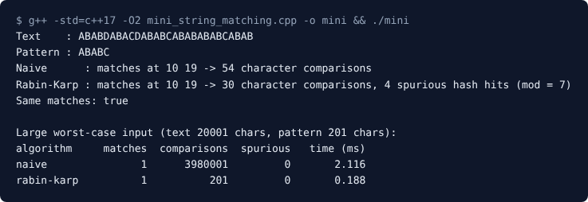
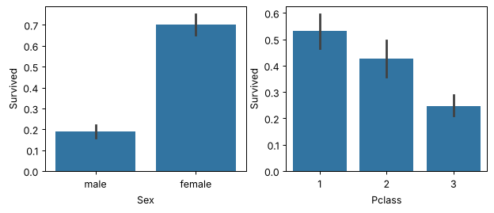

<h1 align="center">LP3 Mini-Projects Report</h1>
<h3 align="center">Laboratory Practice III (410246): DAA, Machine Learning, Blockchain Technology</h3>

<h2 align="center">1\. DAA: Naive vs Rabin-Karp String Matching</h2>

**Problem statement.** Implement the naive and the Rabin-Karp string-matching algorithms and observe how they differ on the same input.

**Objectives.** Find all occurrences of a pattern in a text with both algorithms, and compare the matches, the number of character comparisons, the hash hits and the run time.

**Methodology.**

- *Naive:* slide the pattern over the text one position at a time and compare character by character. Worst case O(n x m).
- *Rabin-Karp:* compute a rolling hash of each text window. Only when the hash equals the pattern hash are the characters compared. A hash match with different characters is a *spurious hit*. Expected O(n + m).

**Implementation.** One C++17 file, `daa/mini_string_matching.cpp`, using only the standard library (`string`, `vector`, `chrono`, `iostream`). It first runs a short text with a tiny modulus (7) to force spurious hits, then a worst-case text (`aaaa...ab`) to compare run times. It takes no input.

**Results.**

<em>Figure 1: Program output</em>

| Input | Naive comparisons | Rabin-Karp comparisons | Time (naive / Rabin-Karp) |
|---|---|---|---|
| Short text (28 chars), pattern `ABABC` | 54 | 30 (4 spurious hits, mod 7) | - |
| Worst case (20001 chars, pattern of 201) | 3,980,001 | 201 | 2.116 ms / 0.188 ms |

Both algorithms find the same matches (positions 10 and 19). On the worst-case text Rabin-Karp makes about 20,000 times fewer comparisons and is about 11 times faster. A small modulus causes spurious hits, which is why a large modulus is used in practice.

<h2 align="center">2\. Machine Learning: Titanic Survival Prediction</h2>

**Problem statement.** Build a machine learning model that predicts which passengers survived the Titanic shipwreck from passenger data (age, gender, class, fare, family and so on).

**Objectives.** Explore the data, clean it and create features, train two classifiers, and compare them with accuracy and a confusion matrix.

**Methodology.**

1. Explore: survival rate by sex and by class.
2. Clean: fill missing ages with the median, drop `Cabin`, `Ticket` and `PassengerId`, take the title (Mr, Mrs, Miss) from the name, add `FamilySize = SibSp + Parch`, and one-hot encode the categorical columns.
3. Split into training (75%) and test (25%) sets.
4. Train Logistic Regression and Random Forest, and compare accuracy and confusion matrices.

**Implementation.** One Jupyter notebook, `ml/mini_titanic_survival.ipynb`, using pandas, numpy, scikit-learn, seaborn and matplotlib. Run it with `uv sync` and `uv run jupyter lab`, then *Run All*.

**Results.** The Kaggle file is not bundled, so the notebook runs on synthetic data with the same columns (891 rows, survival rate 0.356). **The numbers below are from that synthetic data, so a run on the real `train.csv` will give different scores.**

<em>Figure 2: Survival rate by sex and by passenger class</em>

| Model | Accuracy | Confusion matrix [[TN, FP], [FN, TP]] |
|---|---|---|
| Logistic Regression | 0.803 | [[129, 15], [29, 50]] |
| Random Forest | 0.803 | [[124, 20], [24, 55]] |

Women survived far more often than men (0.70 against 0.19), and first-class passengers more than third-class (0.53 against 0.25). Both models reach the same accuracy. The most important features for the Random Forest are `Title_Mr`, `Sex_male`, `Fare`, `Age` and `Pclass`.

<h2 align="center">3\. Blockchain Technology: E-Voting System</h2>

**Problem statement.** Develop a blockchain-based application for e-voting.

**Objectives.** An admin sets up an election, only registered voters can vote and only once, votes are public and cannot be changed, and anyone can read the result.

**Methodology.** A smart contract controls the election in three phases:

| Phase | Who can do what |
|---|---|
| Registration | The admin adds candidates and registers voters, then starts voting |
| Voting | Each registered voter votes once for an existing candidate |
| Ended | The admin has closed voting and anyone can read the winner |

**Implementation.** One Solidity file, `bt/mini_evoting.sol` (contract `EVoting`, Solidity 0.8.20 or newer), written and tested in the Remix IDE, with MetaMask on the Sepolia test network. The rules are enforced with `require()` checks and the `onlyAdmin` and `inPhase` modifiers. Events (`VoteCast`, `PhaseChanged`) record every action on the chain. Main functions: `addCandidate`, `registerVoter`, `startVoting`, `vote`, `endVoting`, `getCandidate` and `winner`. The steps are in `bt/mini_evoting_guide.md`.

**Results (expected behaviour).** These results follow from the contract's `require()` checks. Deployment screenshots, gas and fee values from Remix and Sepolia are not part of this report yet.

| # | Action | Result |
|---|---|---|
| 1 | Admin adds 2 candidates | `candidateCount()` returns 2 |
| 2 | A non-admin calls `addCandidate` | Reverts: "Only the admin can do this" |
| 3 | Registered voter votes once | Candidate's count and `totalVotes` increase by 1 |
| 4 | The same voter votes again | Reverts: "You have already voted" |
| 5 | An unregistered account votes | Reverts: "You are not a registered voter" |
| 6 | Vote before `startVoting()` | Reverts: "Not allowed in the current phase" |
| 7 | `winner()` after `endVoting()` | Returns the candidate with the most votes |

**Limits.** Votes are public and linked to the voter's address, so the system is transparent but not secret. A real system would also verify voter identity and use a privacy technique such as zero-knowledge proofs.
