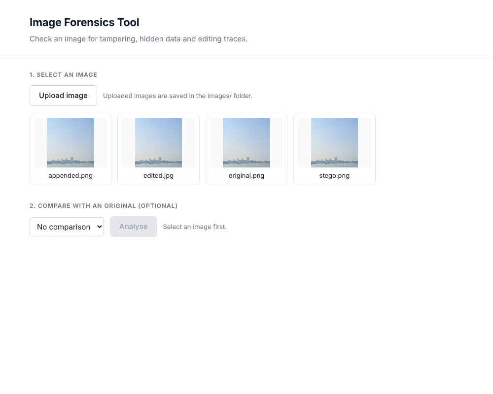
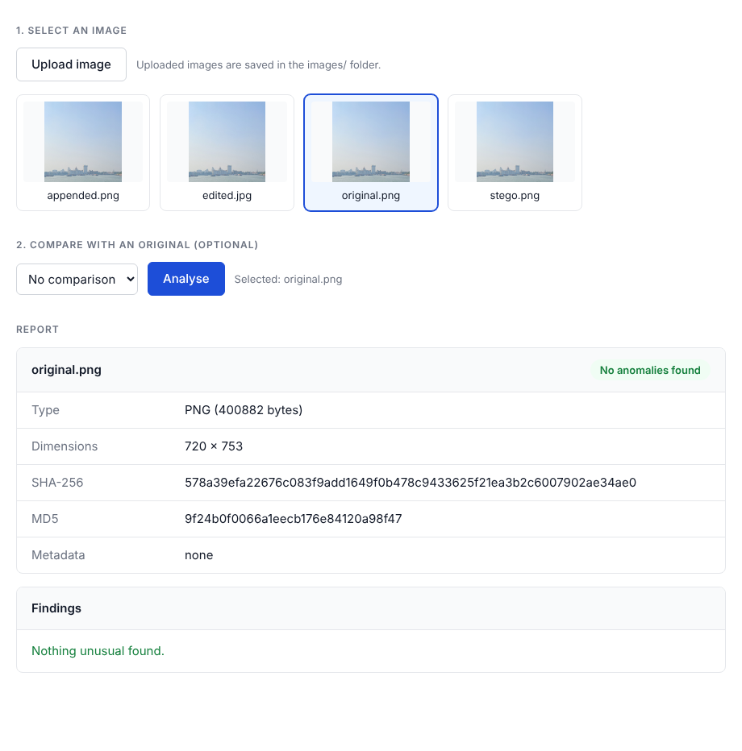
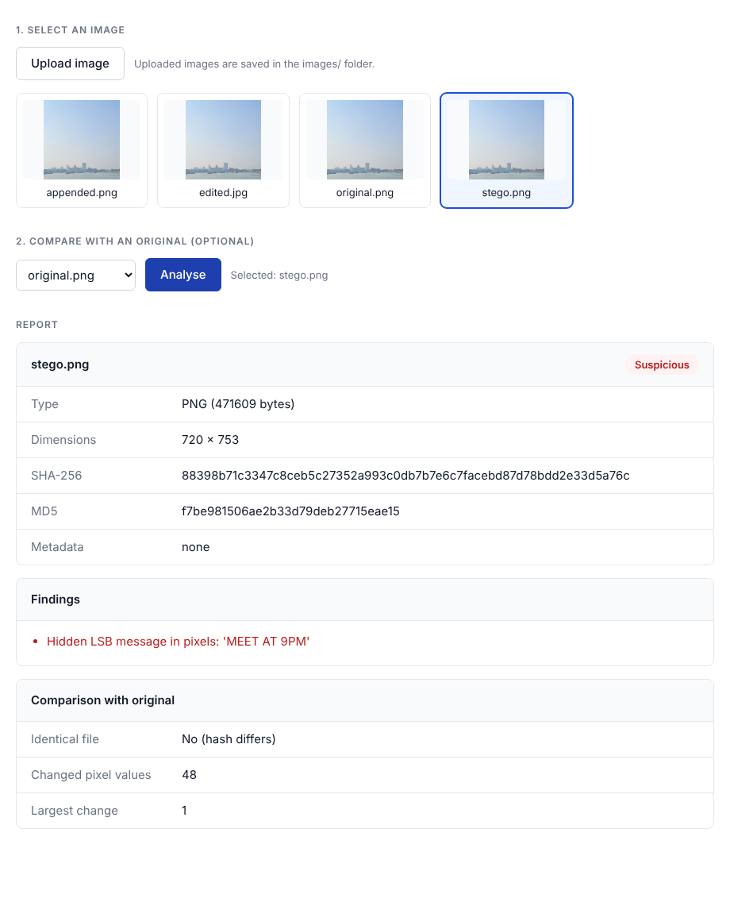
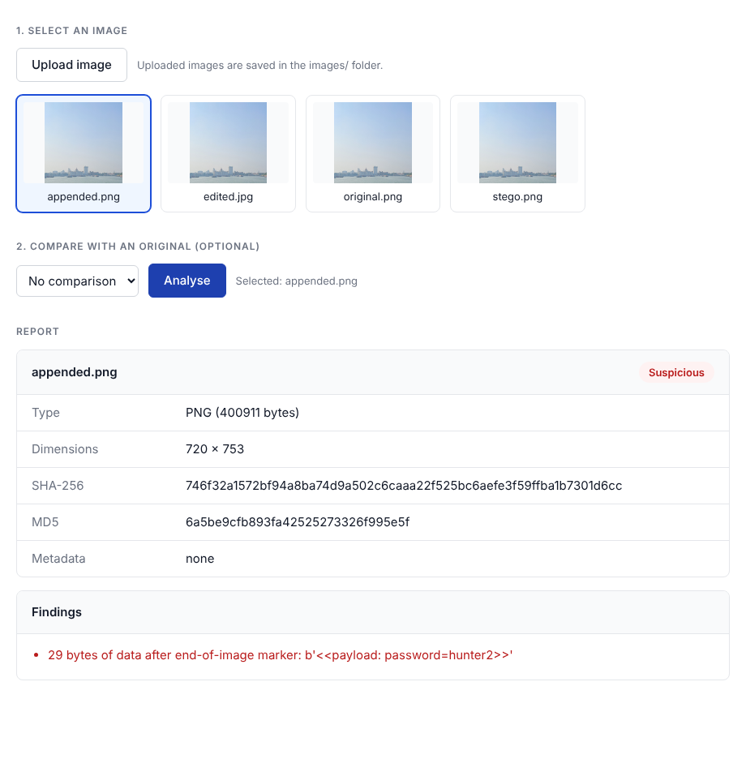
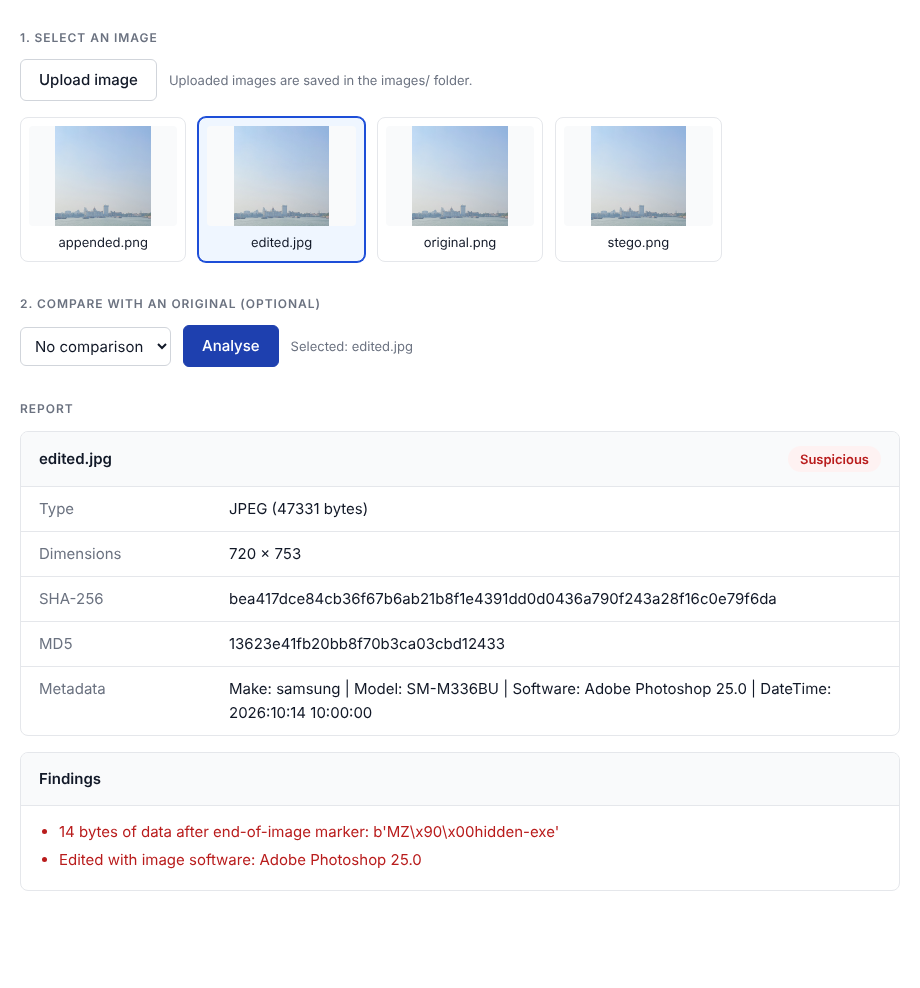
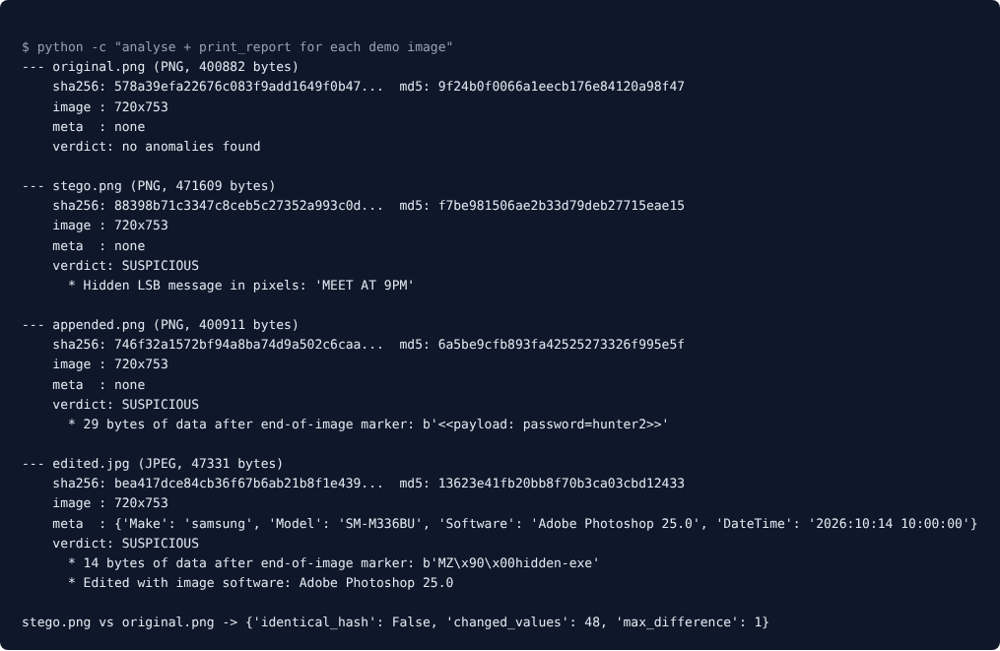

<h1 align="center">Image Forensics Tool</h1>
<h3 align="center">Cyber Security and Digital Forensics (CSDF) - Mini-Project Report</h3>
<p align="center">Lab Practice IV (410247) &nbsp;|&nbsp; Vaishnav Mankar &nbsp;|&nbsp; Roll No. 41252</p>

<hr/>

<h2 align="center">1\. Problem Statement</h2>

Design and develop a tool for the digital forensics of images.

A photo can be tampered with in ways nobody can see. Secret data can be hidden inside the pixels or after the end of the file, the editing software can be recorded in the metadata, and a file can be renamed so that it looks like an image when it is not. Opening such a file in a photo viewer shows nothing unusual. The tool looks **inside** the file instead of at the picture, and reports the signs of tampering or hidden data it finds.

<h2 align="center">2\. Objectives</h2>

1. Identify the real type of a file from its first bytes, so a spoofed extension is caught.
2. Compute SHA-256 and MD5 hashes to fingerprint a file.
3. Read the metadata (PNG text chunks and JPEG EXIF) and flag traces of editing software.
4. Detect data hidden after the end-of-image marker of a PNG or JPEG.
5. Detect a message hidden in the least significant bits (LSB) of the pixels.
6. Compare a suspect image with an original, pixel by pixel.
7. Give a simple interface: a web page and a pytest file where an `image_path` is set. Uploaded images are kept in an `images/` folder.

<h2 align="center">3\. Methodology</h2>

The tool uses only the Python standard library. Each image goes through the same six checks, and every anomaly is added to a list of findings. An image with no findings is reported as "no anomalies found", otherwise as "suspicious".

| Step | Check | How it works |
|---|---|---|
| 1 | File type | The first bytes (file signature) are compared with the PNG signature (`89 50 4E 47`) and the JPEG signature (`FF D8`). The file name is not trusted. |
| 2 | Hashes | SHA-256 and MD5 of the whole file. Changing one byte changes both. |
| 3 | Metadata | PNG `tEXt` chunks and the JPEG EXIF block are read. Software names such as Photoshop or GIMP are flagged. A JPEG with no EXIF is noted as possibly stripped. |
| 4 | Data after image end | Viewers stop reading at the end-of-image marker (`IEND` chunk in PNG, `FF D9` in JPEG). Any bytes after it are reported with a preview. |
| 5 | LSB steganography | The PNG is decoded to pixel values. The last bit of each value is collected, and the bits are read as text from the start. A readable message is reported. |
| 6 | Original vs suspect | Two PNGs of the same size are compared value by value. The number of changed values and the largest difference are reported. |

**Why LSB hiding is invisible:** every colour value is a number from 0 to 255. Changing the last bit changes the number by at most 1, which the eye cannot see. A message of 12 characters needs only 96 bits, so a few dozen pixel values change.

**Test images.** Four demo images are made from one photograph (720 x 753). They look identical in a photo viewer.

| Image | What was done to it |
|---|---|
| `original.png` | Nothing. Clean reference. |
| `stego.png` | The message `MEET AT 9PM` is hidden in the pixel LSBs. |
| `appended.png` | The text `<<payload: password=hunter2>>` is added after the end of the image data. |
| `edited.jpg` | EXIF says `Adobe Photoshop 25.0`, and 14 bytes starting with `MZ` (a Windows program signature) follow the image end. |

<h2 align="center">4\. Implementation Details</h2>

**Folder `csdf/mini_project/`**

| File | Purpose |
|---|---|
| `forensics.py` | The analysis code (about 200 lines): PNG and JPEG parsing, hashes, LSB extraction, comparison, `print_report` |
| `make_samples.py` | Builds `stego.png` and `appended.png` from `original.png` when they are missing |
| `web_app.py` | A small local web server (standard library `http.server`) |
| `index.html` | The web page: choose or upload an image, optionally choose an original, press Analyse |
| `test_forensics.py` | pytest tests. `image_path` at the top sets the image to analyse. |
| `images/` | Demo images and anything uploaded from the web page |

**Main functions in `forensics.py`**

- `analyse(path)` runs all the checks on one file and returns a report with `type`, `size`, `sha256`, `md5`, `info`, `metadata` and `findings`.
- `parse_png` and `parse_jpeg` walk through the chunks or markers of the file, collecting dimensions, metadata and the offset where the image ends.
- `decode_pixels` inflates the PNG data and undoes the row filters. `extract_lsb_message` then collects the last bits.
- `compare_images(original, suspect)` returns `identical_hash`, `changed_values` and `max_difference`, or an error if the two images cannot be compared.

**Web page.** `web_app.py` serves `index.html` and four requests: list the images, send one image, save an upload, and analyse. Safety measures:

- Uploaded file names are cleaned (`safe_name`), so `../../evil.png` becomes `evil.png`.
- Only image extensions are accepted, and uploads are limited to 20 MB.
- Only files inside `images/` can be read or analysed.

**Run**

```
uv run python csdf/mini_project/web_app.py     # web page at http://localhost:8000
uv run pytest csdf/mini_project -s             # tests; set image_path to test your own image
```

<h2 align="center">5\. Results</h2>

**5.1 Web page.** The page lists the four images. The first screenshot shows the page before any analysis; the Analyse button stays disabled until an image is chosen.

<p align="center"></p>
<p align="center"><em>Figure 1: Web page with the four demo images</em></p>

**5.2 Clean image.** `original.png` shows no anomalies.

<p align="center"></p>
<p align="center"><em>Figure 2: Report for original.png</em></p>

**5.3 Hidden message in pixels.** `stego.png` is reported as suspicious and the message `MEET AT 9PM` is recovered. Compared with `original.png`, exactly 48 pixel values differ and the largest difference is 1, which is why the change cannot be seen.

<p align="center"></p>
<p align="center"><em>Figure 3: Report for stego.png, compared with original.png</em></p>

**5.4 Data after the image end.** `appended.png` has the same pixels as the original (0 changes) but 29 extra bytes after the end marker, and so a different hash.

<p align="center"></p>
<p align="center"><em>Figure 4: Report for appended.png</em></p>

**5.5 Editing software and hidden program.** `edited.jpg` shows `Software: Adobe Photoshop 25.0` in its metadata and 14 bytes starting with `MZ` after the image end.

<p align="center"></p>
<p align="center"><em>Figure 5: Report for edited.jpg</em></p>

**5.6 Terminal report.** The same checks printed in the terminal (the output used by the pytest file):

<p align="center"></p>
<p align="center"><em>Figure 6: Reports for all four images</em></p>

**5.7 Summary of results**

| Image | Expected | Result |
|---|---|---|
| `original.png` | No anomalies | No anomalies found |
| `stego.png` | Hidden message | `MEET AT 9PM` found, 48 values differ from the original |
| `appended.png` | Extra data | 29 bytes after the end marker found |
| `edited.jpg` | Editing trace, extra data | Photoshop 25.0 and 14 extra bytes found |

**5.8 Tests.** The test file has 10 tests: the four images above, the pixel comparison, refusing to compare a PNG with a JPEG, JPEG dimensions, a second JPEG appended to a first, upload name cleaning, and the `image_path` test. All 10 passed.

**Limits.** Pixel checks work on ordinary 8-bit PNG files only. The LSB check looks for plain text at the start of the pixel data, so a message hidden in another way will not be found. Metadata can be faked, so an editing trace is a clue and not proof.

**Conclusion.** The tool finds hidden data, editing traces and extra bytes that cannot be seen in a photo viewer, with a simple web page and a short pytest file for the demonstration.
