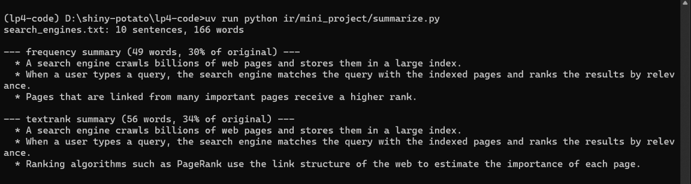

<h1 align="center">Document Summarization System</h1>
<h3 align="center">Information Retrieval (IR) - Mini-Project Report</h3>
<p align="center">Lab Practice IV (410247) &nbsp;|&nbsp; Vaishnav Mankar &nbsp;|&nbsp; Roll No. 41252</p>

<hr/>

<h2 align="center">1\. Problem Statement</h2>

Design and develop a document summarization system. Long articles take time to read, so the system should shorten an article to its few most important sentences while keeping them in the original order.

<h2 align="center">2\. Objectives</h2>

1. Split an article into sentences and clean the words (tokenise, remove stop words, stem).
2. Score every sentence for importance in two ways: word frequency and TextRank.
3. Produce a summary of the top N sentences and show how much shorter it is.
4. Use the NLTK library from the syllabus for the text processing.
5. Keep the input in a text file (`articles/`), so any article can be summarized by changing one path.

<h2 align="center">3\. Methodology</h2>

The system performs **extractive summarization**: it selects existing sentences and does not rewrite them.

| Step | Operation | NLTK part used |
|---|---|---|
| 1 | Split the article into sentences | `sent_tokenize` |
| 2 | Split each sentence into words and make them lowercase | `word_tokenize` |
| 3 | Remove stop words ("the", "is", "of") | `stopwords` |
| 4 | Reduce each word to its stem ("searches", "searching" become "search") | `PorterStemmer` |
| 5 | Score every sentence (two methods below) | - |
| 6 | Keep the top N sentences and print them in original order | - |

**Method 1: Word frequency.** Words that occur often in the article are important. The score of a sentence is the average normalised frequency of its words, so a sentence made of frequent words ranks high.

**Method 2: TextRank.** Sentences are treated like web pages in PageRank. Each sentence is a node, and the similarity between two sentences (the number of shared words, normalised by sentence length) is the weight of the link between them. PageRank is then run on this graph with damping factor 0.85 for 50 iterations. A sentence that shares words with many other sentences gets a high score.

<h2 align="center">4\. Implementation Details</h2>

| File | Purpose |
|---|---|
| `summarizer.py` | Sentence splitting, word cleaning, `frequency_scores`, `textrank_scores` and `summarize(text, count, method)` |
| `summarize.py` | Reads `article_path` (a `.txt` file), uses `num_sentences`, prints both summaries and their size compared with the original |
| `test_summarizer.py` | 14 pytest tests |
| `articles/` | Three sample articles: `search_engines`, `electric_buses`, `online_learning` |

Libraries: `nltk`, plus `math` and `collections.Counter` from the standard library. The first run downloads two small NLTK data packages (`punkt_tab`, `stopwords`), which needs internet once. The code does this automatically in `setup_nltk()`.

**Run**

```
uv run python ir/mini_project/summarize.py     # set article_path and num_sentences at the top
uv run pytest ir/mini_project -s               # tests
```

<h2 align="center">5\. Results</h2>

The sample article `search_engines.txt` has 10 sentences and 166 words. One sentence in it is deliberately off-topic: "My neighbour bought a new bicycle last week." The article was summarized to 3 sentences with both methods.

<p align="center"></p>
<p align="center"><em>Figure 1: Output of summarize.py for search_engines.txt</em></p>

| Method | Words in summary | Share of original | Sentences chosen |
|---|---|---|---|
| Word frequency | 49 | 30% | crawls billions of pages; query matched and ranked by relevance; pages linked from many important pages rank higher |
| TextRank | 56 | 34% | crawls billions of pages; query matched and ranked by relevance; PageRank uses the link structure of the web |

**Observations**

- Both methods choose the two central sentences about crawling and about matching and ranking a query.
- They differ in the third sentence: word frequency picks the sentence about pages linked from important pages, while TextRank picks the sentence that explains PageRank, which shares words with many other sentences.
- The off-topic bicycle sentence is left out by both, because it shares no words with the rest of the article.
- Each summary is about one third of the original and the sentences stay in their original order.

**Tests.** All 14 pytest tests passed (`14 passed in 25.84s`, including the NLTK download on first run). They check the summary length, that sentences stay in order, that the off-topic sentence is left out, that every article in `articles/` gets shorter with both methods, and the cases of asking for more sentences than exist and of empty text.

**Limits.** The summary can read a little choppy because sentences are copied without rewriting. Rewriting in new words is abstractive summarization, which is a different project. The method works best on plain English articles of 6 to 8 sentences or more.

**Conclusion.** The system produces a short, readable summary using NLTK. Word frequency and TextRank both find the key sentences and ignore the irrelevant one, and TextRank connects the summarization problem to the PageRank algorithm studied in the IR syllabus.
